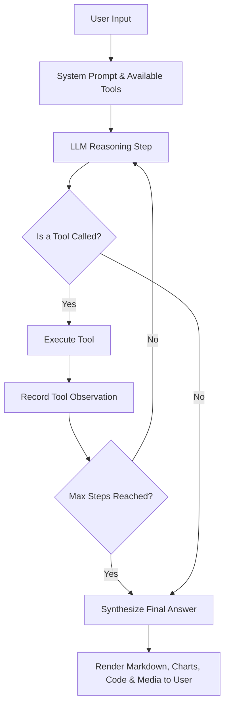

# 📚 Puter.js Autonomous Agent & Full-Stack AI Documentation

This document provides complete, in-depth documentation for building full-stack, autonomous AI applications with **Puter.js** using the **User-Pays Model** and zero API keys.

---

## Table of Contents

1. [Alibaba Cloud Model Studio vs Puter.js](#1-alibaba-cloud-model-studio-vs-puterjs)
2. [The User-Pays Economic Model](#2-the-user-pays-economic-model)
3. [Supported AI Models & Provider Catalog](#3-supported-ai-models--provider-catalog)
4. [Autonomous Agentic Architecture (ReAct Loop & Tool Calling)](#4-autonomous-agentic-architecture)
5. [Built-in Tool Ecosystem](#5-built-in-tool-ecosystem)
6. [Puter.js Full API Specification](#6-puterjs-full-api-specification)
7. [Deployment & Production Hosting](#7-deployment--production-hosting)

---

## 1. Alibaba Cloud Model Studio vs Puter.js

### The Problem with Traditional Cloud Tiers
Alibaba Cloud Model Studio offers a free promotional tier for its flagship **Qwen** model series:
- **Quota**: 1,000,000 input tokens and 1,000,000 output tokens.
- **Expiration**: Valid for strictly **90 days** from the moment of account activation.
- **The Pitfall**: 1 million tokens is sufficient for prototyping, but once the 90 days elapse or the quota is consumed, every subsequent user prompt is billed to your personal developer account under pay-as-you-go pricing. If your application gains traction or goes viral, your account faces uncapped, escalating bills.
- **The Architectural Burden**: You must build, deploy, and maintain an intermediate backend server (Express, FastAPI, or Next.js) simply to hide your secret API key from client-side inspection.

### The Puter.js Solution
With **Puter.js** ([docs.puter.com](https://docs.puter.com)):
- **Zero API Keys**: No API key is ever created, embedded, or proxied.
- **No 90-Day Clock**: Your application never expires.
- **Zero Developer Billing**: You pay $0.00 whether 10 people or 100,000 people use your app.
- **100% Client-Side**: You can build a production-grade full-stack application as a static HTML/JS bundle without running any backend servers.

---

## 2. The User-Pays Economic Model

Under the [User-Pays Model](https://docs.puter.com/user-pays-model/):
1. **User Identity & Quota**: When a user visits your app, Puter provides access through their personal Puter account. Puter grants users generous free AI allowances, or allows them to connect their preferred balance.
2. **Developer Cost Isolation**: AI requests made by user Alice are deducted from Alice's account; requests by user Bob are deducted from Bob's account.
3. **Infinite Scalability**: As a developer, your infrastructure and AI operational costs remain flat at **$0.00**, eliminating the risk of unexpected cloud invoices.

```
+----------------------------------------------------------------+
| Traditional Cloud Model:                                      |
|  [User A] \                                                   |
|  [User B]  ──► [Your Backend Server] ──► [Cloud Provider API]  |
|  [User C] /     (Holds Developer Key)     (Charges DEVELOPER)  |
+----------------------------------------------------------------+

+----------------------------------------------------------------+
| Puter.js User-Pays Model:                                      |
|  [User A] ──► [User A's Puter Quota] ──► [AI Model] (Cost: $0) |
|  [User B] ──► [User B's Puter Quota] ──► [AI Model] (Cost: $0) |
|  [User C] ──► [User C's Puter Quota] ──► [AI Model] (Cost: $0) |
|  * Developer pays $0.00 forever and manages 0 backend servers  |
+----------------------------------------------------------------+
```

---

## 3. Supported AI Models & Provider Catalog

Puter.js supports hundreds of AI models from industry-leading providers. You can access all of them via `puter.ai.chat(prompt, { model })`.

### 1. Alibaba Qwen Models
- `qwen/qwen-2.5-72b-instruct`: Flagship multilingual reasoning, coding, and general intelligence model.
- `qwen/qwen-2.5-coder-32b-instruct`: State-of-the-art coding specialist optimized for code generation and debugging.
- `qwen/qwen3.8-flash`: High-speed, low-latency model designed for real-time streaming interfaces.
- `qwen/qwen3.6-flash`: Fast, efficient conversational model.

### 2. DeepSeek Models
- `deepseek/deepseek-chat` (DeepSeek V3): Flagship open-weights foundation model.
- `deepseek/deepseek-reasoner` (DeepSeek R1): Advanced reasoning model with transparent chain-of-thought scratchpad.

### 3. OpenAI Models
- `openai/gpt-4o`: Flagship omni model.
- `openai/gpt-4o-mini`: Ultra-fast and efficient general model.
- `openai/o1`: Next-generation reasoning model for complex STEM challenges.

### 4. Anthropic Claude Models
- `anthropic/claude-3-5-sonnet`: Premier model for agentic workflows, complex coding, and structured writing.
- `anthropic/claude-3-haiku`: Fast conversational model.

### 5. Google & Open-Source
- `google/gemini-2.0-flash`: Next-gen multimodal speed and tool-use leader.
- `mistral/mistral-large-latest`: Mistral's flagship enterprise reasoning model.
- `meta-llama/llama-3.3-70b-instruct`: Meta's high-capacity open model.

---

## 4. Autonomous Agentic Architecture

PuterAgent Studio implements an autonomous **ReAct (Reasoning + Acting)** execution loop.

### How the Autonomous Loop Works



### Dual-Mode Tool Dispatching
1. **Native Tool Calling**: Passes standard OpenAI-compatible JSON tool schemas inside `puter.ai.chat(messages, { tools })`.
2. **ReAct Prompt Fallback**: If an AI model or proxy lacks native tool schema parsing, PuterAgent automatically injects structured ReAct guidance (`Thought:`, `Action:`, `Action Input:`) and extracts actions using regex, making **every single model autonomous**.

---

## 5. Built-in Tool Ecosystem

PuterAgent Studio comes pre-configured with 8 agent tools:

| Tool Name | Purpose | Example Input |
| :--- | :--- | :--- |
| `web_search` | Search live web via DuckDuckGo | `{ "query": "Qwen 2.5 benchmarks" }` |
| `fetch_web_content` | Fetch & parse clean web content | `{ "url": "https://example.com" }` |
| `run_javascript` | Client-side sandbox code execution | `{ "code": "return Math.sqrt(144);" }` |
| `render_chart` | Interactive Chart.js graph | `{ "title": "Sales", "chartType": "bar", ... }` |
| `generate_image` | Puter AI Image Generation | `{ "prompt": "Futuristic neon city" }` |
| `puter_fs_write` | Write file to Puter Cloud Drive | `{ "path": "notes.md", "content": "..." }` |
| `puter_fs_read` | Read file from Puter Cloud Drive | `{ "path": "notes.md" }` |
| `puter_kv_store` | Store key-value in Puter Cloud DB | `{ "key": "settings", "value": {...} }` |
| `text_to_speech` | Audio voice synthesis | `{ "text": "Task complete!" }` |

---

## 6. Puter.js Full API Specification

### 1. Including the SDK
Add the Puter.js client library to your `<head>`:
```html
<script src="https://js.puter.com/v2/"></script>
```

### 2. AI Chat & Streaming
```javascript
// Streaming chat completion with token-by-token updates
const responseStream = await puter.ai.chat('Explain quantum computing', {
  model: 'qwen/qwen-2.5-72b-instruct',
  stream: true
});

for await (const chunk of responseStream) {
  const token = chunk?.text || '';
  document.getElementById('output').textContent += token;
}
```

### 3. Function / Tool Calling
```javascript
const tools = [
  {
    type: 'function',
    function: {
      name: 'getWeather',
      description: 'Get weather for location',
      parameters: {
        type: 'object',
        properties: { location: { type: 'string' } },
        required: ['location']
      }
    }
  }
];

const res = await puter.ai.chat('What is the weather in Tokyo?', {
  model: 'openai/gpt-4o',
  tools: tools
});

if (res.message?.tool_calls) {
  const toolCall = res.message.tool_calls[0];
  console.log('Model requested tool:', toolCall.function.name);
}
```

### 4. Multimodal & Media
```javascript
// Image Generation
const imageElement = await puter.ai.txt2img('A golden retriever wearing astronaut goggles');
document.body.appendChild(imageElement);

// Text-to-Speech
const audio = await puter.ai.txt2speech('Welcome to PuterAgent Studio');
audio.play();
```

### 5. Cloud Key-Value Store
```javascript
// Set
await puter.kv.set('user_profile', { theme: 'dark', maxSteps: 5 });

// Get
const profile = await puter.kv.get('user_profile');

// Delete
await puter.kv.del('user_profile');

// List keys
const keys = await puter.kv.list();
```

### 6. Cloud Filesystem (`puter.fs`)
```javascript
// Write file
await puter.fs.write('Documents/report.txt', 'Analysis results...', {
  overwrite: true,
  createMissingParents: true
});

// Read file
const content = await puter.fs.read('Documents/report.txt');

// List directory
const files = await puter.fs.readdir('Documents');
```

### 7. User Authentication
```javascript
// Check status
const isLoggedIn = await puter.auth.isSignedIn();

// Sign In
await puter.auth.signIn();

// Profile
const user = await puter.auth.getUser();
console.log('Username:', user.username);

// Sign Out
await puter.auth.signOut();
```

---

## 7. Deployment & Production Hosting

### 1-Click Deployment via Puter Cloud Hosting
Puter includes free hosting for static web apps. You can deploy your entire app directory directly:

```javascript
// From browser or Puter console:
const site = await puter.hosting.create('my-puter-agent', '.');
console.log('Live URL:', `https://${site.subdomain}.puter.site`);
```

Your application is instantly published with:
- Global CDN distribution
- Free SSL certificate (`https://`)
- Custom subdomain support
- Zero hosting maintenance fees

---

## 8. Desktop OS Architecture & Local Computer Access

In addition to running as a client-side web application, PuterAgent Studio ships with a full **Electron Desktop Runtime** allowing the AI agent to have direct access to your local computer.

### The Desktop IPC Bridge (`electron/preload.js`)
Electron uses a secure context isolation bridge:
- `window.desktopAPI.readFile(path, { startLine, endLine })`: Reads any file from the user's hard drive.
- `window.desktopAPI.writeFile(path, content, { append })`: Creates or overwrites files and generates parent directories recursively.
- `window.desktopAPI.editFile(path, targetContent, replacementContent)`: Performs pinpoint search-and-replace code refactoring.
- `window.desktopAPI.listDirectory(path, { recursive, maxDepth })`: Scans workspace directories and files.
- `window.desktopAPI.createDirectory(path)`: Creates local folders.
- `window.desktopAPI.runCommand(command, { cwd, timeout })`: Runs shell/PowerShell commands in the workspace with captured stdout, stderr, and exit codes.
- `window.desktopAPI.selectDirectory()`: Native Windows directory picker dialog.
- `window.desktopAPI.getSystemInfo()`: OS, architecture, memory, CPU cores, active workspace path.

### Local Agentic Coding Workflow
1. The user asks: *"Create a full Express server in this folder with a tests suite, run npm test, and fix any errors."*
2. **Step 1 (Inspection)**: Agent executes `local_list_directory` to see existing files.
3. **Step 2 (Code Generation)**: Agent executes `local_write_file` to write `package.json`, `index.js`, and `test.js`.
4. **Step 3 (Execution)**: Agent runs `local_run_command("npm test")` via PowerShell.
5. **Step 4 (Self-Correction)**: If a test fails, the agent reads the error trace, executes `local_edit_file` to patch the code, and re-executes `local_run_command` until green!

### Packaging & Executables
- **NSIS Setup Installer**: `dist/PuterAgent Studio Setup 2.5.0.exe` (122 MB)
- **Standalone Portable Executable**: `dist/PuterAgent Studio 2.5.0.exe` (111 MB)
- **Unpacked App Directory**: `dist/win-unpacked/PuterAgent Studio.exe`

---

## Summary
By leveraging **Puter.js** and the **Desktop Native Runtime**, you eliminate:
1. Backend servers and reverse proxies.
2. 90-day trial clocks from Alibaba Cloud Model Studio.
3. Leaked API key security risks.
4. Skyrocketing AI infrastructure bills.
5. Sandbox limitations (giving the AI full, local agentic coding power on your machine).

You can now ship full-stack, autonomous, production-ready AI applications and desktop installers directly to users with zero friction!
